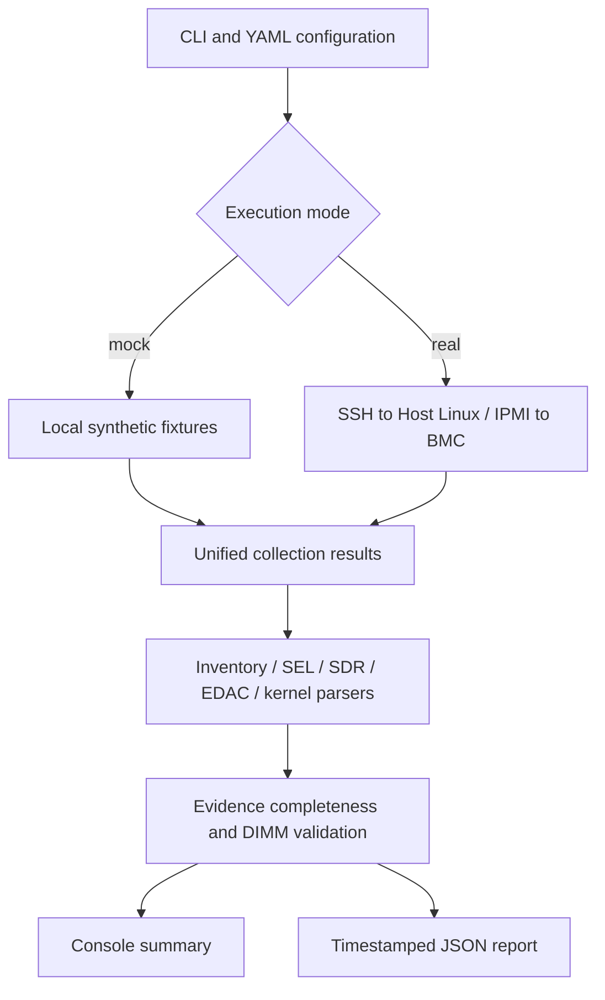
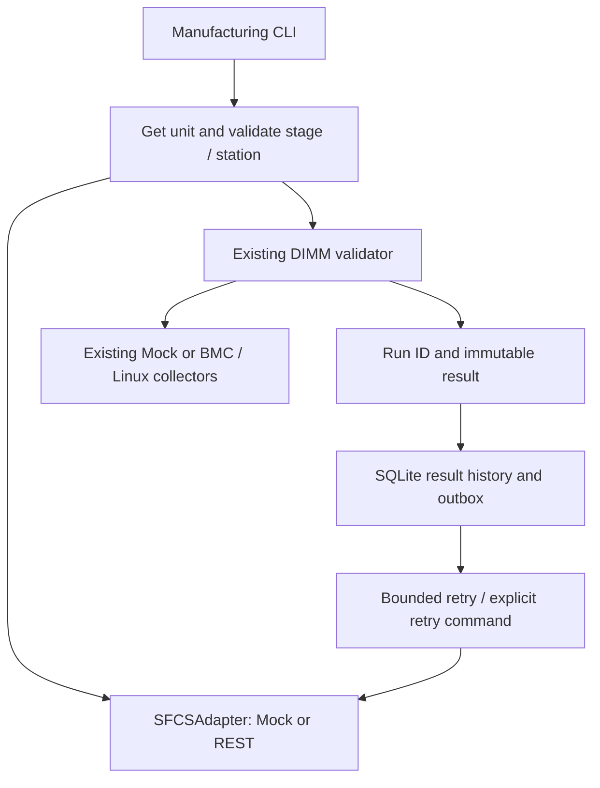

# Server DIMM Health Validator

A lightweight, **read-only Python CLI** for demonstrating server DIMM diagnostic automation. It collects memory inventory and diagnostic evidence from BMC/IPMI and Host Linux, interprets ECC-related observations, and produces console and JSON reports. Built as an interview portfolio project for Lab Engineering / Hardware Validation Technician roles.

> **Demo scope:** All included sample logs, server IDs and IPs are fictional. Mock Mode works offline. Real Mode provides SSH/IPMI command collection but **has not been validated on physical hardware**. This is not an official Intel or MiTAC test procedure.

## Architecture



The collection adapter changes by mode; the parsing and validation logic stays the same. The tool is limited to DIMM inventory, memory sensors, ECC counters and memory-related events.

## Requirements and installation

- Python 3.11+ (substitute your installed 3.11+ interpreter in the commands)
- `pip` and the packages in `requirements.txt`
- Mock Mode: no network, root privileges, BMC, SSH or `ipmitool` required
- Real Mode: authorized reachable server, configured SSH keys and host key, local `ipmitool`, supported BMC IPMI interface, and read permissions for Host Linux diagnostics

```bash
cd Server-DIMM-Health-Validator
python3.11 -m venv .venv
source .venv/bin/activate
python -m pip install -r requirements.txt
python -m pytest -q
```

## Quick start — offline mock scenarios

```bash
python -m src.main --config config/test_env.yaml
python -m src.main --mode mock --scenario healthy
python -m src.main --mode mock --scenario corrected_error
python -m src.main --mode mock --scenario uncorrected_error
python -m src.main --mode mock --scenario unavailable
```

| Scenario | What it demonstrates | Expected result | Exit code |
| --- | --- | --- | --- |
| `healthy` | Required evidence available; observed CE=0, UE=0 | PASS | 0 |
| `corrected_error` | Corrected ECC counter exceeds demo threshold | FAIL | 2 |
| `uncorrected_error` | Uncorrected ECC detected | FAIL | 2 |
| `unavailable` | Required EDAC evidence missing | UNKNOWN | 3 |

`WARNING` uses exit code `1`. Nonzero diagnostic exit codes indicate test outcomes, not necessarily application crashes. Additional scenarios: `missing_dimm` → FAIL (2), `sensor_unsupported` and `sensor_critical` → WARNING (1), `malformed_inventory` and `incomplete_edac` → UNKNOWN (3). All are available through the same `--scenario` option and appear in `--help`.

## Configuration

Edit `config/test_env.yaml` to set server identity, mock scenario, collection switches, expected populated DIMM slots and demonstration thresholds. All example IP addresses use documentation-only ranges. Do not commit real credentials, internal addresses or proprietary logs.

```yaml
execution:
  mode: mock
  mock_scenario: healthy
  timeout_seconds: 30
thresholds:
  fail_on_explicit_dimm_sensor: false
  max_corrected_errors: 0
  max_uncorrected_errors: 0
  expected_slots: [DIMM_A1, DIMM_A2, DIMM_B1, DIMM_B2]
```

**Thresholds are illustrative demo policy, not vendor acceptance criteria.** `expected_slots` describes slots expected to be populated; other empty slots are not automatically failures.

## What the tool collects

| Source | Real-mode command/interface | Purpose |
| --- | --- | --- |
| BMC SEL | `ipmitool ... sel elist` | Historical memory-related events |
| BMC SDR | `ipmitool ... sdr elist` | Memory sensor observations, if exposed |
| Host inventory | `sudo -n dmidecode -t 17` over SSH | SMBIOS DIMM presence and metadata |
| Host kernel | `sudo -n dmesg -T` over SSH | Historical EDAC/MCE/memory messages |
| Host EDAC | Read `/sys/devices/system/edac/mc/mc*/{ce_count,ue_count}` over SSH | Controller-level ECC counters, if supported |

Collection failure, unsupported hardware monitoring, incomplete parsing and no observed errors are **different states**. The validator should not turn missing evidence into zero errors or PASS.

## Interpretation and limitations

- **PASS:** Required evidence is complete and no configured failure criterion is met. This is not proof of comprehensive DIMM health.
- **FAIL:** Trustworthy evidence meets a configured failure criterion (for example, a CE/UE count above the demo threshold or a confirmed missing expected DIMM).
- **WARNING:** Suspicious/noncritical evidence requiring review but not establishing a current failure.
- **UNKNOWN:** Required collection or interpretation is incomplete, with no confirmed FAIL.
- BMC SEL and kernel events can be historical; timestamps and assert/deassert context matter.
- EDAC counters are often cumulative at memory-controller scope. Without validated topology mapping, **do not assign counts to a particular physical DIMM**. Overall PASS can coexist with unknown per-slot ECC attribution.
- SMBIOS `dmidecode` inventory does not prove DIMM health. BMC sensor names, EDAC availability and firmware behavior vary by platform.
- A corrected ECC error may be operationally recoverable; this project's zero-error threshold is intentionally strict for demonstration.

## JSON reporting

Each execution produces a structured report containing the server/test context, collection and parsing status, observed inventory, controller-level ECC counters, sensor/event evidence, conclusions, recommendations and limitations. Each run retains a unique UTC timestamp + sanitized scenario + UUID history file; `dimm_report.json` is atomically replaced as the latest-run convenience copy. Both writes are atomic individually, not a transaction; if latest-copy replacement fails, an already-written history file remains available. Inspect `reports/` after running. Do not confuse an individual DIMM's unknown attribution with an overall UNKNOWN test result.

## Real Mode — authorized hardware only

Use a separate, explicitly configured YAML file with authorized server addresses. Configure SSH keys and verified known-host entries. Supply the BMC password through `IPMI_PASSWORD` in the environment, not in the repository. Real Mode requires an explicit `--config`; it can be selected through `--mode real` or `execution.mode: real` in that configuration. For a clear demo, select it explicitly:

```bash
# Set IPMI_PASSWORD through your approved secure environment mechanism.
# Do not put a real password in shell history.
python -m src.main --config path/to/authorized_server.yaml --mode real
```

Real Mode is **read-only** and does not reset power, clear SEL, change firmware or perform destructive stress testing. Actual command permissions, SMBIOS formatting, BMC event wording and EDAC topology require validation on the target platform. Never claim hardware validation until performed.

## Run automated tests

```bash
python -m pytest -q
```

Tests use synthetic fixtures and mocks, not external servers. See `VALIDATION.md` for recorded execution results after implementation.

## Two-minute interview demo

1. Explain the YAML configuration and the mock/real adapter boundary.
2. Run `healthy`: show complete evidence and PASS with observed controller CE=0/UE=0.
3. Run `corrected_error`: show the simulated CE increase, the configured threshold and FAIL.
4. Run `unavailable`: explain why absent EDAC evidence means UNKNOWN rather than PASS.
5. Open two JSON reports and explain evidence vs diagnosis, controller-level vs physical DIMM attribution, and how SSH/IPMI would replace fixtures on an authorized server.

**Suggested explanation:** “I designed a read-only Python DIMM diagnostic tool with a mock execution mode and a real SSH/IPMI collection adapter. It collects BMC and Linux evidence, checks inventory and ECC-related observations, and produces auditable results. I intentionally distinguish missing data from healthy results and avoid attributing controller-level errors to a specific DIMM without reliable mapping.”

## Troubleshooting

- `ModuleNotFoundError`: activate the virtual environment and install `requirements.txt`.
- `UNKNOWN` in Mock Mode: inspect source collection and parsing status in the JSON report; do not force PASS.
- Real-mode SSH failure: verify network reachability, key authentication, known-host entry and `sudo -n` permissions.
- Real-mode IPMI failure: verify authorized BMC network access, `ipmitool` installation and `IPMI_PASSWORD`.
- EDAC unavailable: the platform may lack a supported driver or expose counters differently; report UNKNOWN until coverage is understood.

## Safety and future work

Keep the scope limited to DIMM diagnostics. Potential improvements include platform-specific parser fixtures, validated slot mapping, and a defined measurement window or counter baseline. Do not upload proprietary logs or credentials to a public repository.

## Sensor failure policy

The default `thresholds.fail_on_explicit_dimm_sensor: false` treats non-OK sensors as warnings. Opting in permits FAIL only for critical codes (`cr`, `lnr`, `unr`, `lcr`, `ucr`) accompanied by explicit DIMM failure/failed wording, without deasserted or negated failure text. A code alone, temperature wording or `ns` is insufficient. This intentionally narrow rule still needs target-platform review. Historical SEL/kernel entries never establish current failures by themselves.

## Report schema and compatibility

`checks.<source>` contains:

| Field | Meaning |
| --- | --- |
| `collection_status` | SUCCESS, FAILED, or SKIPPED: acquisition only |
| `evidence_status` | COMPLETE, INCOMPLETE, or UNAVAILABLE: usable parser evidence |
| `diagnostic_result` | PASS, WARNING, FAIL, or UNKNOWN: source conclusion |
| `status` | Legacy combined collection/completeness status; not hardware health |

The overall result combines independent evidence: confirmed FAIL dominates missing required evidence, otherwise missing evidence yields UNKNOWN. Only complete EDAC datasets are compared with thresholds. If any controller counter is missing, duplicated or malformed, aggregate CE/UE is `null`, while independently observed controller fields remain available. Counts are never added to SEL/kernel events. No per-slot ECC mapping is required for overall PASS; per-DIMM counts stay `null` and slot attribution UNKNOWN.

Example (abridged unavailable report):

```json
{
  "overall_result": "UNKNOWN",
  "checks": {
    "edac": {
      "collection_status": "FAILED",
      "evidence_status": "UNAVAILABLE",
      "diagnostic_result": "UNKNOWN"
    }
  },
  "observations": {
    "edac": {
      "available": false,
      "controllers": {},
      "corrected_errors": null,
      "uncorrected_errors": null,
      "physical_slot": "unknown"
    }
  }
}
```

Example console excerpt:

```text
Collection status
-----------------
edac: FAILED | evidence: UNAVAILABLE | diagnosis: UNKNOWN

Controller-level ECC counts
---------------------------
CE: UNKNOWN | UE: UNKNOWN | complete: False

Overall diagnostic result
-------------------------
UNKNOWN
```

## Real collection prerequisites and boundaries

SSH uses key authentication (`BatchMode=yes`), strict verified host keys and bounded command timeouts. Provision `known_hosts` beforehand. Approve narrowly scoped noninteractive read permissions for dmidecode, dmesg and the fixed EDAC script. The current EDAC collector uses `sudo -n sh -c`; an administrator should review or replace it with a restricted read-only wrapper rather than granting broad shell permission. BMC credentials come from `IPMI_PASSWORD` with ipmitool `-E`, never command-line password arguments or YAML.

Missing binaries, permission/authentication failure, unreachable endpoints and timeouts produce collection errors, not mock fallback or PASS. Empty/unrecognized required data yields UNKNOWN. Inventory and EDAC remain essential even if disabled; other enabled source switches define required coverage. Relative report directories resolve against the YAML location. The default report directory is `reports/`.

Zero ECC counters are observed snapshots, not comprehensive memory validation. SEL/kernel chronology has no defensible measurement window or baseline. Parsers target common English text formats, not every firmware vocabulary or localization. Sensor semantics and reliable physical mapping require platform validation. Optional ras-mc-ctl enrichment and before/after counter windows remain future work.

Example actual history filename from verification:

`dimm_20261103T041828873405Z_healthy_a90e8e3ea3b741e9ab59667e1835579a.json`

## SFCS / MES manufacturing integration

The manufacturing CLI is separate from `src.main`; all original arguments, diagnostic
results and exit codes remain available. This extension uses synthetic manufacturing
records only. It connects to no MiTAC systems and assumes no proprietary API schema.



`SFCSAdapter` defines `get_unit(serial_number)`,
`validate_station(serial_number, station)`, `upload_result(test_result)` and
`get_test_history(serial_number)`. Collectors and parsers contain no manufacturing
communication. `src/sfcs/workflow.py` owns orchestration; `store.py` owns history;
`delivery.py` owns submission. The implementation uses Python's standard HTTP and
SQLite libraries, with no additional dependencies.

### Offline mock setup and end-to-end example

Install the existing requirements, then run:

```bash
python -m src.sfcs_cli --config config/sfcs_mock.yaml run \
  --serial-number DEMO-SERVER-001 --stage SAT --station SAT-DIMM-01
python -m src.sfcs_cli --config config/sfcs_mock.yaml run \
  --serial-number DEMO-SERVER-001 --stage SAT --station SAT-DIMM-01 \
  --scenario corrected_error
# Copy the failed execution's run_id into the following retest command:
python -m src.sfcs_cli --config config/sfcs_mock.yaml run \
  --serial-number DEMO-SERVER-001 --stage SAT --station SAT-DIMM-01 \
  --scenario healthy --retest-of FAILED_RUN_ID
python -m src.sfcs_cli --config config/sfcs_mock.yaml history --serial-number DEMO-SERVER-001
python -m src.sfcs_cli --config config/sfcs_mock.yaml history --serial-number DEMO-SERVER-001 --remote
python -m src.sfcs_cli --config config/sfcs_mock.yaml retry
```

A second synthetic unit, `DEMO-SERVER-002`, is eligible at `IST-DIMM-01` in IST.
Unknown serial numbers, stage mismatches and invalid stations stop before collection.
Unit lookup or eligibility connection failures also stop testing; there is no cached
eligibility bypass. `mock_offline: true` simulates service unavailability. To demonstrate
upload-only outages, automated tests turn the adapter offline after eligibility and
execution, then reopen the database and retry when online.

Example manufacturing configuration (`config/sfcs_mock.yaml`):

```yaml
adapter: mock
hardware_config: test_env.yaml
database: ../reports/manufacturing.sqlite3
mock_database: ../reports/mock_sfcs.sqlite3
mock_offline: false
retry:
  max_attempts: 3
  backoff: 0.25
```

Paths resolve relative to this YAML file. The hardware config independently selects
mock or real collectors; shipped examples always select mock. Explicitly selecting a
real hardware config requires the same authorized SSH/IPMI setup as the original CLI.
The new CLI prints a JSON summary; integration log messages are JSON on stderr.
Exit codes: 0 = PASS and sent (or successful history/retry); 2 = manufacturing FAIL
and sent; 3 = configuration, eligibility or execution error; 4 = upload pending or
rejected. Original diagnostic CLI exit codes remain unchanged.

### Traceability and manufacturing policy

Every admitted execution receives a UUID Run ID, SN, PN, IST/SAT stage, station,
test name/version, start/completion timestamps in UTC, original DIMM evidence,
failure information and optional parent Run ID. `execution_type` is INITIAL or
RETEST; a retest has its own PASS/FAIL outcome. Parents must already exist locally
for the same SN, stage and station. Multiple retests preserve every previous result.
Preflight failures are logged and do not create a completed DIMM test record.

Manufacturing acceptance is PASS only when the diagnostic result is PASS.
WARNING, UNKNOWN and FAIL become manufacturing FAIL, while `diagnostic_result`
and the complete original report retain their meaning. This is a demonstration
acceptance policy, not a vendor production specification. The manufacturing CLI
stores the full hardware report inside `dimm_health`; the original CLI continues
writing its existing JSON reports.

SQLite stores immutable canonical payloads and separate delivery states:
`pending`, `sent`, `rejected`. Results commit before network submission. A later
`retry` discovers even a run saved before the process could create its queue entry.
Temporary failures get bounded exponential delays (capped at five seconds per delay)
and remain pending after the configured attempts. No background daemon is required;
schedule `retry` externally if desired. Permanent failures remain rejected for review.
An identical Run ID/payload is a no-op; a different payload with the same ID conflicts.
Databases contain hardware evidence: place them in an appropriately protected local
directory and back them up. The latest diagnostic JSON copy is not manufacturing history.

### Example REST contract

`config/sfcs_rest.example.yaml` documents endpoint, timeout and authentication
configuration. Its `.invalid` address is intentionally unusable. Supply a token
through the named environment variable using your secret-management mechanism;
do not put secrets in YAML, commands, committed files or logs. Authentication
supports a configurable header/scheme (for example, Authorization/Bearer or an
API-key header with an empty scheme). HTTPS is required except for loopback tests;
redirects are rejected to prevent credential forwarding. Remote bodies and transport
error strings are excluded from public error messages.

The following is this project's example schema, not any company's SFCS API:

```http
GET /api/units/DEMO-SERVER-001
Authorization: Bearer <environment-supplied-token>
```

```json
{"serial_number":"DEMO-SERVER-001","part_number":"DEMO-PN-001","stage":"SAT","status":"READY","stations":["SAT-DIMM-01"]}
```

```http
POST /api/station-validation
Content-Type: application/json

{"serial_number":"DEMO-SERVER-001","station":"SAT-DIMM-01"}
```

```json
{"eligible":true,"reason":"ready"}
```

```http
POST /api/results
Content-Type: application/json
Idempotency-Key: <run_id>
```

The request body is the full stored result, illustrated here with abbreviated evidence:

```json
{
  "schema_version":1,
  "run_id":"00000000-0000-4000-8000-000000000001",
  "server_sn":"DEMO-SERVER-001",
  "server_pn":"DEMO-PN-001",
  "test_stage":"SAT",
  "station":"SAT-DIMM-01",
  "test_name":"DIMM_HEALTH_VALIDATION",
  "test_version":"1.0.0",
  "started_at":"2026-11-09T12:00:00+00:00",
  "timestamp":"2026-11-09T12:00:01+00:00",
  "execution_type":"INITIAL",
  "retest_of":null,
  "result":"PASS",
  "diagnostic_result":"PASS",
  "failure_information":[],
  "dimm_health":{"overall_result":"PASS"}
}
```

Successful uploads must return a matching acknowledgement:

```json
{"accepted":true,"run_id":"00000000-0000-4000-8000-000000000001"}
```

`GET /api/units/DEMO-SERVER-001/history` returns an array of full result objects.
HTTP 408, 429, 5xx and connection/timeouts are retryable; other HTTP failures
are permanent, with 409 treated as an ID conflict. Invalid JSON, response shapes
or acknowledgements are rejected. An ambiguous timeout can occur after the server
has accepted a result: **the receiving service must enforce Run ID idempotency**,
return the same successful acknowledgement for identical submissions and reject
changed payloads. The client alone cannot guarantee exactly-once remote storage.
Retries use configured backoff; Retry-After negotiation is a future extension.

### Verification and future integrations

Run `python -m pytest -q`. Manufacturing tests cover successful/failing diagnostics,
WARNING/UNKNOWN acceptance, stage/station gates, connection failures, local persistence,
restart recovery, duplicate/conflicting submissions, multiple retests, REST authentication,
timeouts, HTTP errors and malformed responses. REST tests use only loopback HTTP servers.
See `VALIDATION.md` for the current verification record.

Potential extensions include `FileSFCSAdapter` for JSON/CSV exchange, service-specific
request/response mapping, remote retest-parent import, OAuth credential providers,
operator-authorized rejected-result reconciliation, and scheduled outbox workers.
Real factory routing, retention and authorization policies require an explicitly
agreed external service contract and validation in its authorized test environment.
