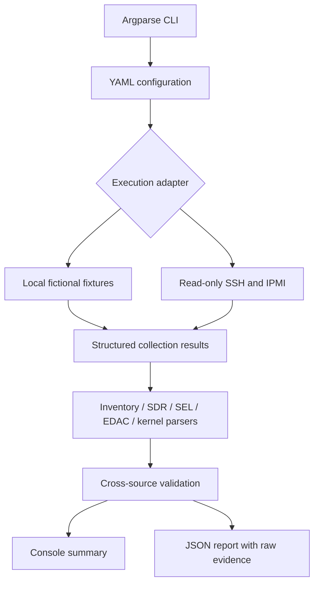

# Server DIMM Health Validator

A small Python 3.11+ command-line portfolio project demonstrating read-only server DIMM diagnostic collection, hardware test automation, evidence interpretation, and JSON reporting for Lab Engineering / Hardware Validation Technician interviews. All bundled identifiers, addresses and logs are fictional. Scope is exclusively memory DIMMs.

## Architecture



## Install

```bash
cd /Users/telliex/Documents/Server-DIMM-Health-Validator
python3.11 -m venv .venv
source .venv/bin/activate
python -m pip install -r requirements.txt
```

Use any installed Python 3.11+ interpreter (for example `python3.13`) if `python3.11` is unavailable.

Only PyYAML is needed at runtime; pytest is used for testing. Mock mode needs no network, server, root, SSH or ipmitool. No frontend, database, Docker or cloud service is involved.

## Run the demonstration

```bash
python -m src.main --config config/test_env.yaml
python -m src.main --mode mock --scenario healthy
python -m src.main --mode mock --scenario corrected_error
python -m src.main --mode mock --scenario uncorrected_error
python -m src.main --mode mock --scenario unavailable
```

| Scenario | Current controller CE / UE | Expected overall | Exit code |
| --- | --- | --- | --- |
| healthy (TC001) | 0 / 0 | PASS | 0 |
| corrected_error (TC002) | 3 / 0 | FAIL | 2 |
| uncorrected_error (TC003) | 0 / 1 | FAIL | 2 |
| unavailable (TC004) | unavailable | UNKNOWN | 3 |

WARNING exits 1. Nonzero diagnostic exit codes are intentional, not CLI crashes. Each run replaces `reports/dimm_report.json`; preserve a copy if comparing runs. Results are deterministic except the UTC report timestamp.

## Configuration

`config/test_env.yaml` contains fictional server identity, connection addresses, execution mode/scenario/timeout, enabled diagnostic sources, thresholds, expected physical slot names, and JSON report directory. Relative report paths resolve against the configuration file's directory. Default config discovery is independent of the current working directory.

Set `thresholds.expected_slots` to the actual expected populated slots for an authorized server. Empty slots outside that list are not missing-DIMM failures. CE and UE thresholds apply to the sum of observed memory-controller counters, not to inferred individual DIMMs. Default demonstration thresholds are zero; they are not Intel or manufacturing acceptance criteria. Required enabled sources must return usable data. Inventory and EDAC are essential even if explicitly disabled, so disabling either yields UNKNOWN unless a confirmed FAIL exists.

## Interpretation

PASS means required enabled collection succeeded and no configured issue was detected. FAIL takes precedence over missing evidence; otherwise missing evidence produces UNKNOWN. Noncritical unavailable sensors and historical memory events produce WARNING. SMBIOS inventory is presence evidence, not proof of health. `ns` or unknown SDR status alone never establishes a faulty DIMM.

Raw command observations and original event text remain separate from conclusions. SEL and kernel events are treated as historical because no test window or counter baseline is defined. They require timestamp review and do not automatically become new failures. EDAC values are current cumulative controller counters with an unknown reset epoch; counts are not added to overlapping SEL/kernel observations. This avoids double counting.

The mock platform deliberately exposes controller/channel evidence without a reliable physical-slot mapping. Individual DIMM ECC counts remain `null` and individual health remains UNKNOWN even when overall evidence passes. A missing expected DIMM has an individual FAIL. No controller count is fabricated as a per-slot count.

## Example console output (TC002, abridged)

```text
SERVER DIMM HEALTH VALIDATOR
Server SN: DEMO-SERVER-001
Test Stage: SAT
Execution Mode: MOCK
[PASS] inventory
[PASS] sel
[PASS] sdr
[PASS] edac
[PASS] kernel
DIMM_B1 | 32 GB | CE: unknown | UE: unknown | UNKNOWN
Controller counters: CE=3, UE=0 (complete=True)
OVERALL RESULT: FAIL
failures: EDAC corrected_errors: 3 exceeds 0 (controller scope)
Report saved: .../reports/dimm_report.json
```

Collection PASS means collection succeeded; it is not a hardware-health conclusion.

## Example JSON report (abridged)

```json
{
  "timestamp": "2026-01-05T10:10:00+00:00",
  "server_sn": "DEMO-SERVER-001",
  "test_stage": "SAT",
  "execution_mode": "mock",
  "test_name": "DIMM_HEALTH_VALIDATION",
  "overall_result": "FAIL",
  "dimm_results": [
    {
      "slot": "DIMM_B1",
      "capacity_gb": 32,
      "corrected_errors": null,
      "uncorrected_errors": null,
      "status": "UNKNOWN",
      "evidence": ["Controller counters cannot be reliably attributed to this physical slot."]
    }
  ],
  "failures": ["EDAC corrected_errors: 3 exceeds 0 (controller scope)"],
  "unavailable_data": []
}
```

Full reports include per-source checks, stdout/stderr, collection errors, parsed inventory, sensors, historical events, controller counters, recommendations, unavailable data, and limitations. JSON writes replace the report atomically.

## Real mode: implemented, not physically validated

Copy the sample YAML to a local configuration and supply an explicitly authorized server's addresses, usernames, expected slots and report path. Real mode always requires an explicit `--config`; it never falls back to mock results.

Prerequisites:

- Local OpenSSH client and `ipmitool`, network access to authorized host and BMC.
- SSH key authentication (agent or standard OpenSSH configuration), verified host keys already present in `known_hosts`. Host-key checking remains enabled.
- A host account with narrowly approved passwordless `sudo -n` permissions for the read-only collectors. The EDAC collector invokes a fixed `sudo -n sh -c` script; have the administrator review it rather than granting broad shell privileges. Platforms allowing direct unprivileged EDAC reads can adapt this collector.
- BMC account with permission to read SEL/SDR, and `IPMI_PASSWORD` supplied securely through the environment. Never commit credentials or private keys.

```bash
# Enter a secret without putting it in shell history (bash/zsh).
read -s 'IPMI_PASSWORD?BMC password: '
export IPMI_PASSWORD
python -m src.main --mode real --config config/authorized_server.yaml
unset IPMI_PASSWORD
```

The prompt syntax above is for zsh; for bash use `read -s -p 'BMC password: ' IPMI_PASSWORD`.

Supported collection commands:

```text
ipmitool -I lanplus -H <BMC_IP> -U <USER> -E sel elist
ipmitool -I lanplus -H <BMC_IP> -U <USER> -E sdr elist
ssh <USER>@<HOST> "sudo -n dmidecode -t 17"
ssh <USER>@<HOST> "sudo -n dmesg -T"
```

The fixed EDAC script reads `ce_count` and `ue_count` for every `mc[0-9]*` directory under `/sys/devices/system/edac/mc/`. It reports unavailable/unreadable counters as collection errors or incomplete evidence. Commands use argument arrays, noninteractive authentication and bounded timeouts. Connection failure, authentication failure, permission denial, missing commands and unsupported monitoring remain explicit errors. No resets, SEL clearing, firmware/BIOS changes or destructive stress tests are performed.

## Testing

```bash
python -m pytest -q
```

Tests run entirely without hardware. They cover configuration validation, inventory/SDR/SEL/kernel/EDAC parsing, thresholds, missing expected DIMMs, unknown sensors, historical events, missing evidence, failure precedence, CLI scenarios and JSON reports. Real subprocess calls are mocked for success, timeout, missing utility, authentication/permission errors, and BMC failure. Mock CLI tests reject any attempt to spawn an external command.

## Limitations and future work

Mock mode demonstrates automation concepts and is not actual hardware validation. Real mode is implemented but has not been validated on a physical server. Firmware-specific SDR/SEL formats, localized dmidecode output, differing EDAC drivers and restricted kernel logs may need platform-specific parsers. No reliable physical DIMM mapping is inferred from controller totals. Recognizable text is not a guarantee that a platform exposes every possible diagnostic event. The tool performs a snapshot, not a comprehensive memory test.

Potential improvements: approved platform-specific DIMM mapping, before/after counter baselines, explicit UTC test windows and timestamp normalization, optional `ras-mc-ctl` enrichment where installed, and sanitized real-hardware fixture validation. None of these are required to run the local demo.
